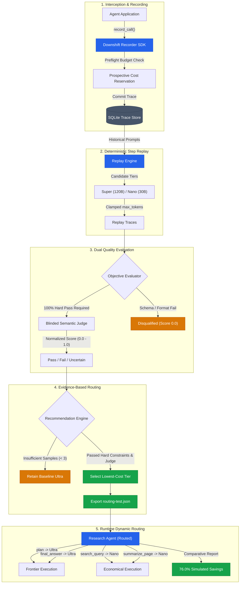

# Downshift: Evidence-Based Model Tier Router for AI Agents

> **Nebius × NVIDIA Global AI Hackathon Project**  
> An automated, trace-driven optimization framework that records multi-step agent executions, replays intermediate steps against cheaper parameter tiers, evaluates objective and semantic quality, and dynamically routes agent stages to minimize inference spend without sacrificing task accuracy.

[](https://www.python.org/)
[](#7-verification--test-suite)
[](https://github.com/astral-sh/ruff)
[](https://mypy-lang.org/)
[](#4-safety--dual-lock-architecture)

---

## ⚡ Judge Fast-Track (30-Second Quickstart)

Experience the complete, reproducible Downshift optimization pipeline in your terminal with **zero API keys and zero configuration**:

```powershell
# 1. Navigate to the repository
cd D:\Downshift

# 2. Synchronize project dependencies (using uv)
uv sync

# 3. Execute the deterministic end-to-end demo
uv run python examples/research_agent/demo.py
```

In approximately **4 seconds**, this automated demonstration will:
- Record a multi-step **Baseline Agent** run on frontier **Nemotron Ultra (550B)** ($0.003630).
- Replay all eligible steps against **Super (120B)** and **Nano (30B)** candidate tiers.
- Execute **100% hard objective constraint validation** (schema, JSON, tool call arguments).
- Run a **blinded semantic quality judge** scoring outputs without model or price bias.
- Generate evidence-backed routing recommendations and export `routing-test.json`.
- Execute the **Dynamically Routed Agent**, demonstrating a **76.0% simulated cost reduction** ($0.000871) with 100% checklist compliance.

---

## 1. Problem Statement & Core Insight

Autonomous AI agents frequently suffer from massive inference overspend by routing every single step—including mechanical actions like search query generation, intermediate document summarization, or schema normalization—to frontier foundation models (such as 550B+ parameter Ultra models).

While complex strategic planning and intricate final synthesis often justify frontier models, intermediate steps can frequently be executed by lightweight, highly efficient models (such as 120B Super or 30B Nano parameter tiers) at **a fraction of the cost**.

| NVIDIA Nemotron-3 Tier | Target Model Identifier | Input Rate ($/Mtok) | Output Rate ($/Mtok) | Relative Cost |
| :--- | :--- | :---: | :---: | :---: |
| **Ultra (550B)** | `nvidia/Nemotron-3-Ultra-550b-a55b` | \$1.00 | \$3.00 | **100.0%** (Baseline) |
| **Super (120B)** | `nvidia/nemotron-3-super-120b-a12b` | \$0.30 | \$0.90 | **30.0%** (70% savings) |
| **Nano (30B)** | `nvidia/NVIDIA-Nemotron-3-Nano-30B-A3B` | \$0.06 | \$0.24 | **7.0%** (93% savings) |

**Downshift eliminates guesswork** by collecting execution traces, replaying intermediate steps across cheaper candidate models, grading objective and semantic equivalence, and proving whether a cheaper tier preserves required quality before routing live agent traffic to it.

---

## 2. The 5-Stage Optimization Lifecycle



### Stage 1: SDK Interception & Prospective Budgeting
- Transparently wraps OpenAI-compatible clients via `downshift.wrap_client(client)`.
- Enforces thread-safe prospective budget reservations (`check_and_reserve`) *before* model dispatch, estimating input tokens using character heuristics plus protocol framing overhead (+50 tokens).
- Latches `has_unreconciled_cost = True` if a timeout or missing usage metadata occurs, blocking untracked spend.

### Stage 2: Step Replay with Bounded Tokens
- Extracts recorded prompts from intermediate steps (`Step.request`) and re-executes them against alternative candidate tiers (`super`, `nano`).
- Enforces strict token ceilings: missing `max_tokens` defaults to 600; oversized values are clamped to 4096 to prevent runaway completion loops.

### Stage 3: Dual-Gate Quality Evaluation
- **Gate 3A: Objective Constraint Evaluator (`checks.py`)**: Enforces 100% hard constraints. Checks for valid JSON syntax, tool call schema conformance, required dictionary keys, non-empty content, and normal finish reasons. Any objective failure short-circuits evaluation with score 0.0.
- **Gate 3B: Blinded Semantic Judge (`judge.py`)**: An LLM-as-a-judge prompt completely blinded to model identity, tier name, and pricing. Scores semantic intent, factual accuracy, and task utility on a normalized 0.0 to 1.0 scale (≥ 0.70 passes).

### Stage 4: Recommendation Engine & Routing Map Export
- Requires a minimum of 3 evaluations per tag to establish statistical confidence. If sample count is insufficient, the system safely defaults to the baseline model.
- Automatically selects the cheapest qualifying tier meeting all constraints and exports a portable configuration map (`routing-test.json`).

### Stage 5: Runtime Dynamic Routing
- Injects the exported JSON configuration directly into the agent.
- Per-tag dynamic model selection routes intermediate tasks (`search_query`, `summarize_page`) to Nano rates while preserving Ultra rates for reasoning-heavy tags (`plan`, `final_answer`).

---

## 3. Architecture & Modular Structure

Downshift is organized into clean, decoupled layers:

| Module / Component | File Location | Responsibility |
| :--- | :--- | :--- |
| **Recorder SDK** | `sdk/downshift/recorder.py` | Transparent client wrapping, ContextVar run isolation, prospective cost reservation, timeout handling, and secret redaction. |
| **Trace Database** | `server/app/models.py`<br>`server/app/db.py` | SQLModel schemas (`Run`, `Step`, `Replay`, `Evaluation`, `ModelPrice`) with SQLite Write-Ahead Logging (WAL) and busy timeout. |
| **Pricing & Config** | `prices.yaml`<br>`server/app/config.py` | Canonical model ID resolution, strict boolean parsing for live verification, and environment variable management. |
| **Replay Engine** | `server/app/replay.py` | Step re-execution across tiers, bounded token clamping, and default-deny client authorization boundaries. |
| **Objective Checks** | `server/app/checks.py` | Hard constraint validator for JSON schema, tool argument fidelity, and finish reason integrity. |
| **Semantic Judge** | `server/app/judge.py` | Blinded LLM judge scoring, objective failure short-circuiting, and deterministic mock evaluation double. |
| **Router Engine** | `server/app/router.py` | Sample threshold enforcement, qualification logic, cost reduction calculation, and JSON routing map export. |
| **CLI Suite** | `server/app/cli.py` | Subcommand interface supporting the `latest` keyword across `list`, `inspect`, `replay`, `evaluate`, `judge`, and `recommend`. |
| **Token Audit** | `scripts/audit_token_usage.py` | Strictly read-only local database audit distinguishing reconciled estimated costs from unresolved unknowns without DDL. |
| **Catalog Checker** | `scripts/check_nebius_models.py` | Metadata-only query (`GET /v1/models`) to verify account-visible models on Nebius Token Factory with zero inference calls. |
| **Research Agent** | `examples/research_agent/` | Multi-step research agent (`agent.py`), baseline runner (`run_baseline.py`), comparison runner (`compare_runs.py`), and demo (`demo.py`). |

---

## 4. Safety & Dual-Lock Architecture

To prevent accidental, unexpected, or runaway cloud provider spend during local development, testing, and evaluation, Downshift enforces a **Dual-Lock Defense-in-Depth Boundary**:

```
[Outbound Dispatch Path]
       │
       ▼
[Lock 1: Execution Mode Check]
   Is execution_mode == "live"?
       ├── NO  ──► [REFUSED] "execution_mode is 'offline'. Set execution_mode='live'."
       └── YES ──► Continue to Lock 2
                     │
                     ▼
             [Lock 2: Verified Pricing Gate]
                Is verified_for_live == true in prices.yaml?
                    ├── NO  ──► [REFUSED] "prices.yaml has verified_for_live=false."
                    └── YES ──► Authorized for live network dispatch
```

1. **Lock 1: Explicit Execution Mode (`execution_mode="offline"` by default)**:
   - Direct APIs (`replay_run`, `judge_replay`, `judge_run`) and CLI commands default strictly to offline mode.
   - Any live or untrusted client provided to an offline function is refused before network evaluation.
2. **Lock 2: Central Pricing Verification (`verified_for_live: false` in `prices.yaml`)**:
   - Even when `execution_mode="live"` is requested, live dispatch is blocked until an operator reviews official provider rates and explicitly sets the YAML boolean `verified_for_live: true`.
   - String values like `"true"`, `1`, or `null` are rejected by strict boolean validation.
3. **Prevention of Dynamic Mock Spoofing**:
   - `_is_authorized_mock` rejects objects attempting duck-typed masquerading via attributes (`self._mock_self = True`) or spoofed module names (`__module__ = "unittest.mock"`).
   - Validates authentic in-memory class pointers (`MockReplayClient`, `MockJudgeClient`, and `unittest.mock.NonCallableMock`).
   - Recursively traverses `__slots__` and `__dict__` across the entire MRO to detect nested or slotted `OpenAI` and `httpx.Client` handles.
4. **Zero-Retry Request Multiplication Safeguard**:
   - SDK-level retries are locked to zero (`nebius_max_retries: int = 0`). Live clients do not silently multiply requests.
5. **Unresolved Cost Latching**:
   - If an API timeout or malformed usage response occurs, `RunContext.has_unreconciled_cost` latches to `True`, permanently blocking subsequent requests within that run context.

---

## 5. Setup & Installation

### Prerequisites
- Windows 10/11, macOS, or Linux
- Python 3.11 or 3.12
- [uv](https://github.com/astral-sh/uv) (recommended) or standard `pip`

### Step 1: Install Dependencies
Open Windows PowerShell (or your preferred shell) in the repository directory:

```powershell
# Navigate to the repository
cd D:\Downshift

# Install all project and development dependencies using uv
uv sync
```

*Note: No environment variables or API keys are required for the offline demo or test suite.*

### Step 2: (Optional) Environment Configuration for Live Use
If you later configure live access with official credentials:
```powershell
# Copy the template environment configuration
Copy-Item .env.example .env

# Configure official credentials in .env:
# NEBIUS_API_KEY=your_key_here
# NEBIUS_BASE_URL=https://api.tokenfactory.nebius.com/v1
# TAVILY_API_KEY=your_key_here
```

---

## 6. How to Run the Demonstration

### Option A: 1-Command Automated Demo (Recommended)
Run the full 7-step optimization and verification lifecycle in a single command:

```powershell
uv run python examples/research_agent/demo.py
```

#### What You Will See:
1. **Baseline Execution**: Research agent executes 11 steps on Ultra (plan, search queries, summaries, final answer).
2. **Step Replay**: 22 candidate evaluations re-executed across Super and Nano tiers.
3. **Hard Objective Check**: 100% pass on schema validity and tool calling arguments.
4. **Semantic Quality Judge**: Blinded LLM judge scores candidate outputs.
5. **Routing Recommendations**: Tags `plan` and `final_answer` retain Ultra (due to sample count protection); tags `search_query` and `summarize_page` safely downshift to Nano.
6. **Dynamic Routing Run**: Agent runs with `routing-test.json`, recording an optimized execution.
7. **Side-by-Side Verification**: Formatted comparison table demonstrating **76.0% simulated cost reduction** ($0.003630 → $0.000871).

---

### Option B: Interactive Step-by-Step CLI Workflow (Using `latest`)
Downshift subcommands natively accept the `latest` keyword, eliminating the need to copy UUIDs:

```powershell
# 1. Run baseline agent (records ~11 steps on Ultra)
uv run python examples/research_agent/run_baseline.py

# 2. Inspect recorded run metadata and step breakdown
uv run python -m server.app.cli latest

# 3. Replay intermediate steps against Super and Nano candidate tiers
uv run python -m server.app.cli replay latest --tiers super,nano

# 4. Run hard objective constraint checks (JSON, schemas, tool calls)
uv run python -m server.app.cli evaluate latest

# 5. Run blinded semantic LLM quality judge
uv run python -m server.app.cli judge latest

# 6. Generate routing recommendations and export routing map
uv run python -m server.app.cli recommend latest --export routing-test.json

# 7. Execute agent with dynamic routing map applied
uv run python examples/research_agent/run_baseline.py --routing-config routing-test.json

# 8. Run side-by-side comparative analysis
uv run python examples/research_agent/compare_runs.py --routing-config routing-test.json
```

---

### Option C: Read-Only Token Usage & Cost Audit
Audit recorded agent runs, prompt/completion tokens, and client-side estimated costs from the local database:

```powershell
uv run python scripts/audit_token_usage.py
```

*Highlights:*
- Strictly read-only; never mutates the database or issues DDL.
- Separates verified **Reconciled Costs** from unresolved calls (timed-out or missing usage steps).
- Discloses that remote provider invoices are unavailable locally and clearly labels missing-usage calls as `UNKNOWN (NOT confirmed $0.00)`.
- Candidate replays and primary agent execution steps are partitioned to prevent double-counting.

---

## 7. Verification & Test Suite

Downshift was last verified with all 179 offline tests passing (179 passed in 18.55s on the latest pre-submission verification run):

```powershell
# Run the complete test suite (last verified run: 179 passed)
uv run pytest -v

# Run static linting
uv run ruff check .

# Run format verification
uv run ruff format --check .

# Run static type checking
uv run mypy sdk server examples scripts tests

# Verify Git whitespace and patch integrity
git diff --check
```

---

## 8. Limitations & Evaluation Integrity

Transparency, scientific honesty, and evaluation integrity are foundational to Downshift:

1. **Simulated Savings vs. Live Model Quality**:
   - In default mock mode, `MockSearchAgentClient` returns deterministic responses to verify workflow orchestration, database transactions, routing algorithms, and cost accounting.
   - Because simulated responses do not experience reasoning degradation across model tiers, **mock-mode 100% checklist scores reflect simulation mechanics only and do not establish semantic quality equivalence in real production models**.
   - The reported **76.0% cost reduction** is recorded strictly from a deterministic offline simulation. Downshift does not claim verified real-world savings, live model quality parity, or production readiness.
2. **Step-Level Replay vs. Multi-Turn Compounding**:
   - Step replays isolate a single step prompt given the historical trajectory.
   - In open-ended autonomous agent workflows, small variations in intermediate outputs may accumulate across subsequent turns. Closed-loop agent comparison (`compare_runs.py`) is required to measure compound multi-turn task completion.
3. **Local Estimates vs. Invoiced Provider Billing**:
   - Downshift computes estimated costs using character heuristics (~4 chars/token + 50 framing tokens) and provider usage counts mapped against `prices.yaml`.
   - `verified_for_live: false` remains in place in `prices.yaml` to ensure no live cloud API calls are dispatched by default.
   - Actual provider billing and live inference still require separate verification against authoritative provider rate cards and official account consoles; OpenAI-compatible API responses do not return billed dollar amounts.
4. **Client-Side Ceilings vs. Server-Side Hard Caps**:
   - The local $0.01 budget ceiling is a client-side estimation check that aborts further requests from that client context. It is **not a provider-enforced spending cap** and cannot replace account spending limits on the remote API provider.

---

## 9. Project Roadmap & Hackathon Milestones

| Milestone / Capability | Status | Verified Deliverables |
| :--- | :---: | :--- |
| **Phase 1: SDK Tracing & Recording** | ✅ Completed | Transparent client interception, ContextVar run isolation, token accounting. |
| **Phase 2a: Step Replay Engine** | ✅ Completed | Idempotent step replay across parameter tiers with concurrency and retry control. |
| **Phase 2b: Objective Evaluations** | ✅ Completed | Deterministic checks for tool call schemas, JSON validity, and finish reasons. |
| **Phase 2c: Semantic Quality Judge** | ✅ Completed | Blinded LLM evaluation with pass/fail/uncertain verdicts and score thresholds. |
| **Phase 3: Routing Recommendations** | ✅ Completed | Recommends lowest-cost safe tier per tag; exports portable JSON routing maps. |
| **Phase 4: Runtime Dynamic Routing** | ✅ Completed | Agent dynamically selects models per tag with baseline fallback and cost verification. |
| **Phase 5: Reproducible Hackathon Demo** | ✅ Completed | One-line end-to-end demo script (`demo.py`) and `latest` keyword across all CLI commands. |
| **Phase 6: Case-Insensitive Self-Healing** | ✅ Completed | Robust canonical model ID resolution regardless of letter casing or database state. |
| **Phase 7: Provider Verification & Audit** | ✅ Completed | Read-only model catalog checker (`check_nebius_models.py`) and token usage audit. |
| **Phase 8: Safety Hardening & Dual-Lock** | ✅ Completed | Dual-lock execution mode, prospective budget reservations, unreconciled cost latches, zero retries, and adversarial test harness. |
| **Phase 9: Submission Freeze & Documentation**| ✅ Completed | Master-grade documentation, judge fast-track, and reproducible offline demo freeze. |
| **Phase 10: Single-Request Smoke Hardening** | ✅ Completed | Strictly bounded Nano-only smoke probe with max_tokens=15, client-side budget disclosure, and offline gate tests (179 tests). |

---

## License

This project is licensed under the MIT License. See [LICENSE](LICENSE) for details.
